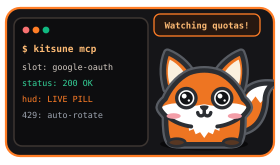
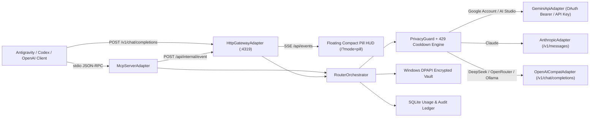

<div align="center">



# Kitsune Router

<p>
  <strong><a href="README.md">English (US)</a></strong> · <a href="README.pt-BR.md">Português (Brasil)</a>
</p>

**Turn your Antigravity, Codex, OpenAI-compatible, and MCP clients into a live multi-account AI workstation with automatic 429 failover, Windows DPAPI key encryption, PrivacyGuard, and an animated floating Pill HUD.**

[](https://nodejs.org/)
[](src/adapters/mcp_server_adapter.ts)
[](src/adapters/dpapi_vault_adapter.ts)
[](src/domain/router_engine.ts)
[](src/adapters/http_gateway_adapter.ts)

</div>

---

<table>
<tr>
<td width="64%" valign="top">

### Curious Companion, Zero-Drama Multi-Account Routing

Just like `codex-with-chatgpt` bridges CLI agents with user-authenticated web accounts, **Kitsune Router** gives Antigravity, Codex, and OpenAI SDK clients one unified local bridge (`127.0.0.1:4319`) backed by your **Google Account (`Gemini 3.8 Pro`, `Gemini 3.5 Flash`, `Deep Research`)**, **Claude (`Sonnet 4.5`, `Opus 4`)**, **DeepSeek (`V3`, `Reasoner R1`)**, **OpenRouter**, and **Ollama**.

When connected via MCP, a live **MJ-Notch Compact Pill HUD** floats smoothly alongside your IDE:
- Sleeps gently (`Zzz`) while waiting for work
- Gives a crisp wake-up startle (**sustinho**) the instant an Antigravity MCP request arrives
- Locks its focus glasses while rotating keys & quotas (`429` failover)
- Dances on completion, gets dizzy on errors, stores valid keys in the safe, and tosses bad keys straight into the trash

</td>
<td width="36%" align="center" valign="middle">
  
</td>
</tr>
</table>

---

## Architecture (`Hexagonal Core + Loopback MCP Relay`)



---

## Supported Providers & Models

| Provider ID | Auth / Plan Connection | Included Catalog Highlights | PrivacyGuard |
| :--- | :--- | :--- | :--- |
| `google-oauth` | Linked Google Account (`ya29...` / Gemini CLI OAuth) | `gemini-3.8-pro`, `gemini-3.5-flash`, `gemini-deep-research` | Public only |
| `google-ai-studio` | Google AI Studio API Keys (multi-slot rotation) | `gemini-2.5-flash`, `gemini-3.8-pro`, `gemini-4-hydrogen`, `gemini-4-argon` | Public only |
| `anthropic` | Claude Console API Key or OAuth session token | `anthropic/claude-sonnet-4-5`, `anthropic/claude-opus-4` | Public only |
| `deepseek` | DeepSeek Platform Key | `deepseek/deepseek-chat` (V3), `deepseek/deepseek-reasoner` (R1) | Public only |
| `openrouter` | OpenRouter Key | `openrouter/deepseek/deepseek-r1:free`, `openrouter/qwen/qwen-2.5-coder-32b-instruct` | Public only |
| `ollama` | 100% offline local engine (`127.0.0.1:11434`) | `ollama/qwen2.5-coder:14b` + any local model | **Confidential & Public** |

---

## Quick Start

### 1. Start the Control Board & Local Gateway

```bash
npm start
```

Open **`http://127.0.0.1:4319`** (panel) or **`http://127.0.0.1:4319/?mode=pill`** (floating Compact Pill HUD).
On Windows, you can also run:

```bash
node src/cli.ts hud
```

### 2. Plug into Antigravity (`mcp_config.json`)

Add `kitsune-router` to your Antigravity / Codex / Claude Desktop MCP configuration:

```json
{
  "mcpServers": {
    "kitsune-router": {
      "command": "node",
      "args": ["C:/Users/tharcio/Downloads/API rotativa Gemini/src/cli.ts", "mcp"]
    }
  }
}
```

When the MCP bridge starts:
1. It checks whether `127.0.0.1:4319` is already listening. If free, it starts the local UI gateway in-process; if already running, it relays live MCP events to the active HUD over loopback HTTP.
2. On Windows desktop sessions, it opens the Compact Pill HUD (pass `--no-hud` or `KITSUNE_NO_HUD=1` for headless/CI environments).
3. Your agent gains **`kitsune_route_prompt`**, **`kitsune_list_models`**, **`kitsune_set_active_profile`**, **`kitsune_usage_summary`**, and **`kitsune_open_pill`**.

### 3. Optional Agent Skill (`skills/kitsune-router/SKILL.md`)

Copy [`skills/kitsune-router/SKILL.md`](skills/kitsune-router/SKILL.md) into your workspace or global skills folder so agents automatically follow `PrivacyGuard` confidentiality rules and wake up the Pill HUD when routing prompts.

### 4. Connect Accounts Safely (User-Initiated)

Inside **`03 // COFRE DPAPI`**:
- **Importar sessao Gemini CLI**: explicitly imports your authenticated local `~/.gemini/oauth_creds.json` access token into Windows DPAPI storage without exposing secrets over plain HTTP responses.
- **Abrir login oficial**: opens Google Account, Gemini Web (`3.8 Pro` / `Deep Research`), Claude Console, or DeepSeek Platform directly in your default browser so you remain 100% in control of authentication and terms of service.

---

## Development & Quality Gates

```bash
npm test
npm run test:coverage
npm run audit:gates
```

- Zero runtime dependencies outside Node.js >= 24 built-ins (`node:sqlite`, `node:http`, `node:crypto`).
- Enforced hexagonal layering (`domain -> ports -> app -> adapters`), max `520` LOC/module, max `60` LOC/function, acyclic dependency graph.
