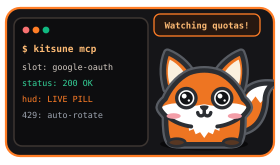
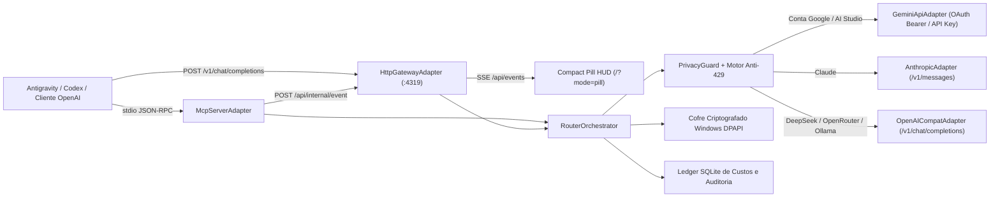

<div align="center">



# Kitsune Router (PT-BR)

<p>
  <a href="README.md">English (US)</a> · <strong><a href="README.pt-BR.md">Português (Brasil)</a></strong>
</p>

**Transforme seu Antigravity, Codex, clientes compatíveis com OpenAI e MCP em uma estação de roteamento multi-contas ao vivo com rotação automática contra erro 429, cofre criptografado Windows DPAPI, PrivacyGuard e HUD flutuante em formato Pílula.**

[](https://nodejs.org/)
[](src/adapters/mcp_server_adapter.ts)
[](src/adapters/dpapi_vault_adapter.ts)
[](src/domain/router_engine.ts)
[](src/adapters/http_gateway_adapter.ts)

</div>

---

<table>
<tr>
<td width="64%" valign="top">

### Raposa Curiosa, Roteamento Multi-Contas Sem Dor de Cabeça

Inspirado na praticidade de projetos como `codex-with-chatgpt`, o **Kitsune Router** entrega ao Antigravity, Codex e SDKs OpenAI um gateway local unificado (`127.0.0.1:4319`) conectado à sua **Conta Google (`Gemini 3.8 Pro`, `Gemini 3.5 Flash`, `Deep Research`)**, **Claude (`Sonnet 4.5`, `Opus 4`)**, **DeepSeek (`V3`, `Reasoner R1`)**, **OpenRouter** (incluindo modelos `:free` para quem está no modo econômico) e **Ollama** 100% local.

Ao conectar via MCP no Antigravity, a **Compact Pill HUD** (estilo MJ Notch Companion) acompanha cada requisição em tempo real:
- Dorme tranquila (`Zzz`) enquanto aguarda chamadas da IDE
- Dá um **sustinho** ao acordar no instante em que uma requisição MCP chega
- Equipa os óculos de foco enquanto rotaciona chaves e cotas (`429` failover automático)
- Comemora com dancinha quando a resposta fecha `200 OK`, fica tonta em falhas, guarda chaves válidas no cofre e joga chaves inválidas direto na lixeira

</td>
<td width="36%" align="center" valign="middle">
  
</td>
</tr>
</table>

---

## Arquitetura (`Núcleo Hexagonal + Loopback MCP Relay`)



---

## Provedores e Planos Suportados

| Provider ID | Conexão de Conta / Plano | Destaques do Catálogo | PrivacyGuard |
| :--- | :--- | :--- | :--- |
| `google-oauth` | Conta Google vinculada (`ya29...` / Gemini CLI OAuth) | `gemini-3.8-pro`, `gemini-3.5-flash`, `gemini-deep-research` | Apenas `public` |
| `google-ai-studio` | Chaves Google AI Studio (rotação multi-slot gratuita/paga) | `gemini-2.5-flash`, `gemini-3.8-pro`, `gemini-4-hydrogen`, `gemini-4-argon` | Apenas `public` |
| `anthropic` | Chave Claude Console ou token OAuth | `anthropic/claude-sonnet-4-5`, `anthropic/claude-opus-4` | Apenas `public` |
| `deepseek` | Chave DeepSeek Platform | `deepseek/deepseek-chat` (V3), `deepseek/deepseek-reasoner` (R1) | Apenas `public` |
| `openrouter` | Chave OpenRouter (suporta tiers `:free`) | `openrouter/deepseek/deepseek-r1:free`, `openrouter/qwen/qwen-2.5-coder-32b-instruct` | Apenas `public` |
| `nvidia` | Chave NVIDIA NIM / Build API | `nvidia/nemotron-3-ultra-550b-a55b`, `nvidia/llama-3.1-nemotron-70b-instruct` | Apenas `public` |
| `freebuff` | Gateway Comunitario Free Buffer (sem chave, ad-block nativo) | `freebuff/codebuff-deepseek-open` | Apenas `public` |
| `ollama` | Motor local 100% offline (`127.0.0.1:11434`) | `ollama/qwen2.5-coder:14b` + modelos locais | **`confidential` e `public`** |

> [!NOTE]
> **Aviso Tecnico sobre o Free Buffer (`freebuff`)**: O Free Buffer e um gateway comunitario publico com filtro automatico de anuncios (`[Sponsored by ...]`). Permite testar modelos de raciocinio sem cadastrar cartao ou chaves, mas por ser um recurso compartilhado externo, esta sujeito a limites de taxa da comunidade, fila e eventuais instabilidades temporarias. Recomendado como contingencia ou para quem nao possui chaves pagas.

---

## Como Começar Rápido

### 1. Suba o Painel e o Gateway Local

```bash
npm start
```

Abra **`http://127.0.0.1:4319`** (painel completo) ou **`http://127.0.0.1:4319/?mode=pill`** (modo Pílula Compacta).
No Windows, você também pode abrir a pílula direto pelo terminal:

```bash
node src/cli.ts hud
```

### 2. Conecte no Antigravity (`mcp_config.json`)

Adicione o `kitsune-router` no arquivo `mcp_config.json` do Antigravity / Codex / Claude Desktop:

```json
{
  "mcpServers": {
    "kitsune-router": {
      "command": "node",
      "args": ["C:/Users/tharcio/Downloads/API rotativa Gemini/src/cli.ts", "mcp"]
    }
  }
}
```

Quando o servidor MCP inicia:
1. Verifica se a porta `127.0.0.1:4319` já está ativa. Se estiver livre, sobe o gateway HTTP junto; se já estiver aberta, retransmite os eventos em tempo real para a HUD ativa.
2. Abre automaticamente a Compact Pill HUD no Windows (use `--no-hud` ou `KITSUNE_NO_HUD=1` em ambientes sem interface gráfica).
3. Libera 8 ferramentas táticas no MCP:
   - **`kitsune_route_prompt`**: roteamento inteligente com failover 429 e proteção de privacidade.
   - **`kitsune_status`**: telemetria em tempo real de slots ativos, saúde e cooldowns.
   - **`kitsune_list_slots`**: lista slots configurados com máscaras de segurança nos tokens.
   - **`kitsune_toggle_slot`**: liga ou desliga chaves e provedores específicos sob demanda.
   - **`kitsune_list_models`**: cataloga modelos disponíveis entre Gemini, Claude, DeepSeek e locais.
   - **`kitsune_open_pill`**: aciona o floating Compact Pill HUD no desktop.
   - **`kitsune_list_workspace_files`**: varre árvore de arquivos e diretórios de projetos Antigravity.
   - **`kitsune_read_workspace_file`**: lê trechos de arquivos com paginação cirúrgica (StartLine/EndLine).
   - **`kitsune_write_workspace_file`**: cria ou aplica modificações pontuais diretamente nos arquivos locais.

### 3. Fluxo Econômico de Tokens & Menu Interativo (Gemini 3.8 Flash Low vs Kitsune MCP)

Ao operar no **Gemini 3.8 Flash** com raciocínio baixo (`low`) ou ao iniciar tarefas com alta demanda de tokens/cota, o assistente aciona a caixa interativa de múltipla escolha (`ask_question`):

1. **Ligar Kitsune Router MCP**:
   - **Decisão do Usuário**: Ligar MCP (Usar as APIs rotativas do Kitsune Router).
   - **Estado do Servidor**: `POST /api/config/mcp-toggle` acionado → `mcpEnabled: true`.
   - **Comportamento Atual**: As chamadas são distribuídas entre os slots do cofre (Google AI Studio, WusRouter, NVIDIA, FreeBuffer, Ollama) com failover 429 automático, sem consumir cota da IDE.

2. **Desligar MCP**:
   - **Decisão do Usuário**: Desligar MCP (Usar o Gemini 3.8 Flash Low nativo da IDE Antigravity).
   - **Estado do Servidor**: `POST /api/config/mcp-toggle` acionado → `mcpEnabled: false`.
   - **Comportamento Atual**: Zero chamadas para o MCP Kitsune Router. Todas as execuções, leituras e escritas rodam diretamente pelo modelo nativo da IDE.

> **Rodapé de Feedback Contínuo**:
> O assistente reporta o estado no encerramento da resposta e permite ao operador alternar instantaneamente a qualquer momento dizendo "ligar MCP" ou "desligar MCP".

### 4. Conecte Contas e Chaves no Cofre DPAPI

Na seção **`03 // COFRE DPAPI`** do painel:
- **Importar sessao Gemini CLI**: importa com 1 clique seu token OAuth local (`~/.gemini/oauth_creds.json`) direto para o cofre criptografado do Windows (DPAPI), sem nunca expor segredos em texto puro na rede.
- **Abrir login oficial**: abre Google Account, Gemini Web (`3.8 Pro` / `Deep Research`), Claude Console ou DeepSeek Platform no seu navegador padrão.

---

## Testes e Portões de Qualidade

```bash
npm test
npm run test:coverage
npm run audit:gates
```

- Zero dependências externas em produção: roda 100% sobre APIs nativas do Node.js >= 24 (`node:sqlite`, `node:http`, `node:crypto`).
- Arquitetura hexagonal validada por script (`domain -> ports -> app -> adapters`), máximo de `520` linhas por módulo, `60` linhas por função e grafo de dependências acíclico.
